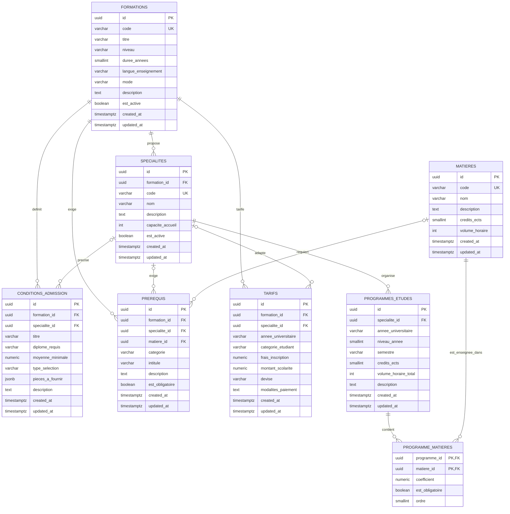

# Modèle de données PostgreSQL — SmartCampus AI

Ce document présente la conception du modèle de données relationnel de **SmartCampus AI** (avec extension `pgvector` activée pour le futur pipeline RAG).

## Tâche 1 : Offre académique, programmes, prérequis, admission et tarifs

### Diagramme Entité-Relation (ERD)

### Relations et cardinalités

| Relation | Cardinalité | Règle métier |
| :--- | :--- | :--- |
| `formations` → `specialites` | `1:N` | Une formation regroupe une ou plusieurs spécialités (`ON DELETE CASCADE`). |
| `specialites` → `programmes_etudes` | `1:N` | Chaque spécialité possède des programmes par année universitaire, niveau et semestre (`UNIQUE(specialite_id, annee_universitaire, niveau_annee, semestre)`). |
| `programmes_etudes` ↔ `matieres` | `N:N` via `programme_matieres` | Une matière peut appartenir à plusieurs programmes avec un coefficient, un caractère obligatoire et un ordre propres. |
| `formations` / `specialites` → `conditions_admission` | `1:N` / `0..1:N` | Les conditions sont définies au niveau de la formation et peuvent être précisées pour une spécialité donnée. |
| `formations` / `specialites` / `matieres` → `prerequis` | `0..1:N` | Un prérequis cible au moins une formation, une spécialité ou une matière (`CHECK` contrainte). |
| `formations` / `specialites` → `tarifs` | `1:N` / `0..1:N` | Les tarifs sont définis par année universitaire et catégorie d'étudiant (`NUMERIC(10,2)` non négatif). |
